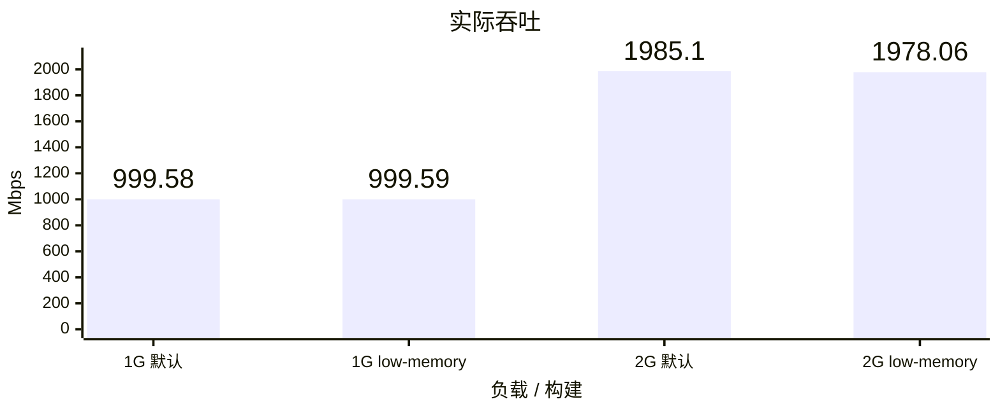
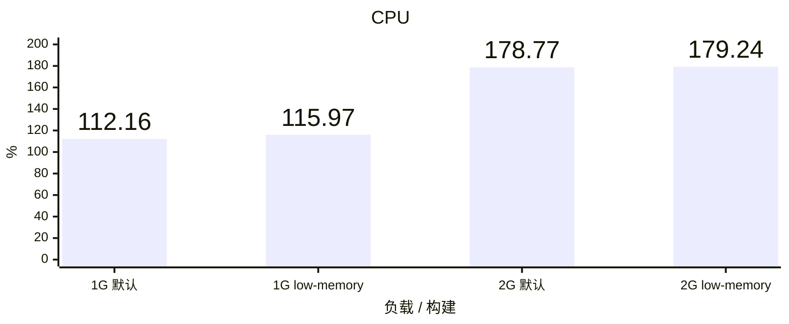
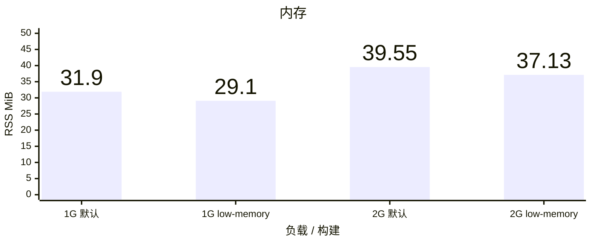
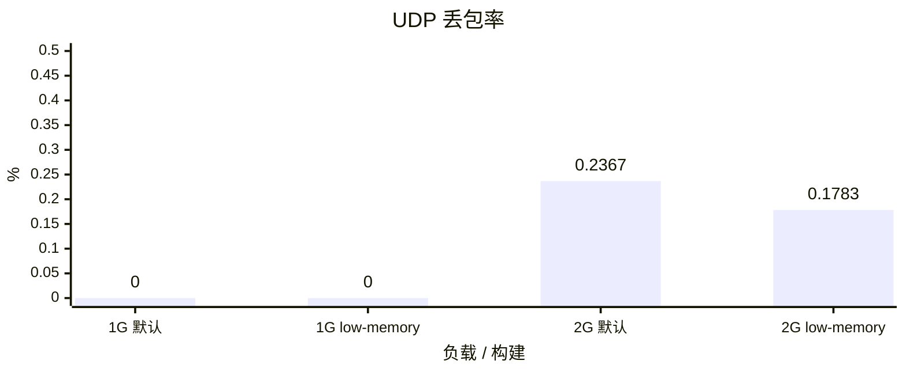

# Vole TUN benchmark

Linux ARM64 普通 Release CLI，Vole `7971629`。默认构建使用 `cli`，低内存构建使用 `cli,low-memory`；源码、依赖、Ubuntu 镜像、原始 GeoData 和流量驱动一致。

每容器 5 CPU、8 GiB、NAT；每档 60 秒混合 TCP/UDP、64 条流、1000 DNS QPS、完整 `geosite:cn` / `geoip:cn`，DIRECT 出口，Controller 开启。TUN / eth0 队列均为 4096，原站队列保持默认。每档每种构建各运行一次，先默认两档，再低内存两档。

CPU 100% 表示一个逻辑核；内存为 CLI 生命周期观测峰值 RSS，包含启动与 Stop；UDP 丢包按实际上下行发送包数加权。Linux RSS 用于内存优化筛选，不能替代真机 Network Extension physical footprint。

默认两档与低内存 1 Gbps 通过压力硬门槛，低内存 1 Gbps 同时达到 35 MiB 软目标。低内存 2 Gbps 实际吞吐为 1978.06 Mbps，低于 1980 Mbps 门槛；RSS 37.13 MiB 高于 35 MiB 软目标，但满足低于 45 MiB 的内存硬门槛。四档数据、DNS、UDP 丢包率和正常退出检查通过。

本次低内存构建的 RSS 在 1/2 Gbps 下分别降低 8.78% / 6.12%；CPU 相对增加 3.40% / 0.26%，2 Gbps 吞吐降低 0.35%。这些是单次对照结果，不能据此确定稳定性能优势。

## 实际吞吐

## CPU

## 内存

## UDP 丢包率

