# Vole TUN benchmark

## 当前 DIRECT 定速对照

A 为 Mihomo `v1.19.32`，B 为 Vole `1e12828`；Linux ARM64 普通 Release、真实 TUN、Controller、完整 CN GeoData。每档每端三轮、每轮60秒；吞吐和CPU取中位数，RSS取生命周期最大值，UDP丢包按三轮上下行实际发送包数加权。CPU 100%表示一个逻辑核。

Vole 九个窗口均通过现行硬门槛及40MiB目标。2/3Gbps存在超时和未完成流，吞吐为活动窗口已收有效载荷，不代表无错误容量；验收口径见[压力标准](acceptance.md)。

### 实际吞吐

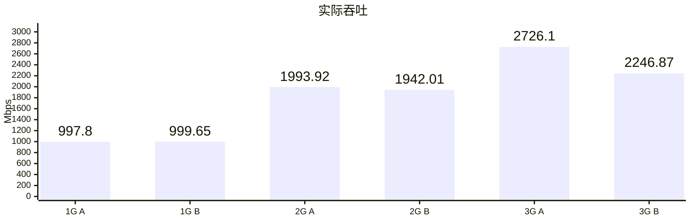

### CPU

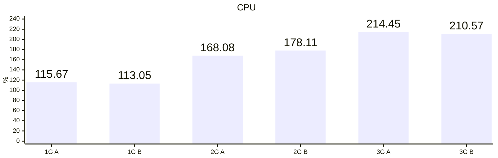

### 内存

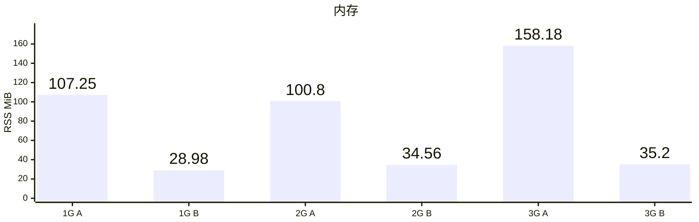

### UDP 丢包率

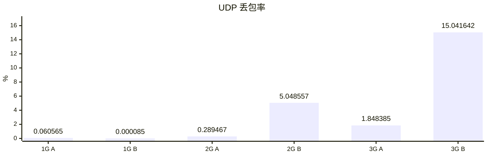

## 当前 H3 对照

A 为 Vole `c42eba7`，B 为 `1e12828`；真实 TUN，各三轮固定量负载。吞吐和传输窗口CPU取中位数，RSS取生命周期最大值；DoH单列QPS，UDP为端到端交付丢包率。

L4、IP/T、IP/U分别表示MASQUE L4、IP TCP、IP UDP；TT为TrustTunnel。

九项业务与清理通过，B全部达到40MiB目标；旧相对判据保留7 PASS、2 FAIL。MASQUE L4吞吐下降约3.1%、内存下降约8.9%；IP UDP吞吐下降约0.66%、内存下降约1.11%。

### 实际吞吐 TCP

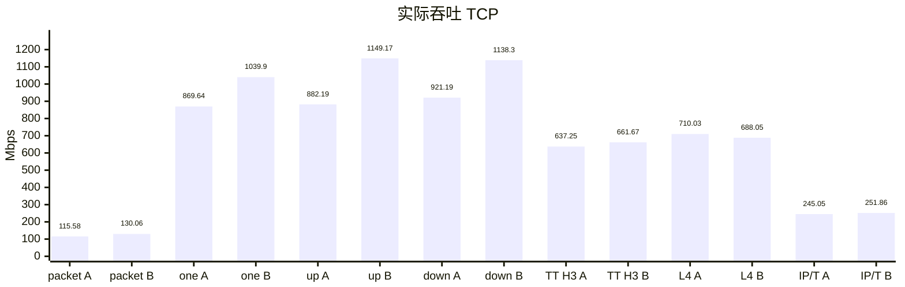

### 实际吞吐 UDP

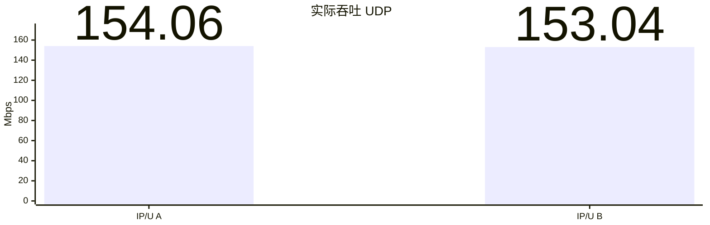

### 实际吞吐 DoH

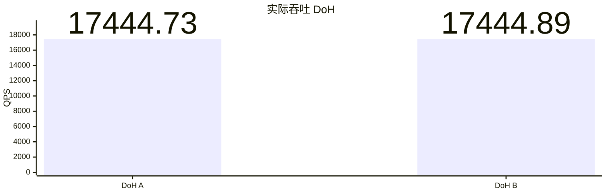

### CPU

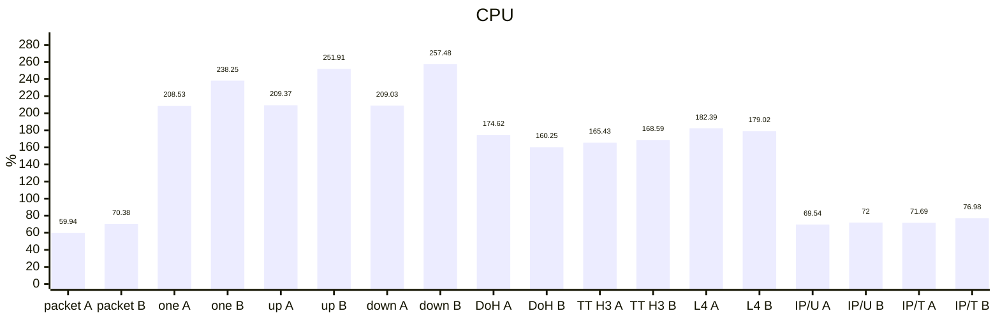

### 内存

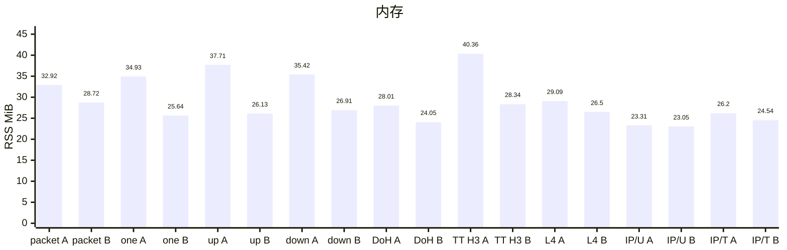

### UDP 丢包率

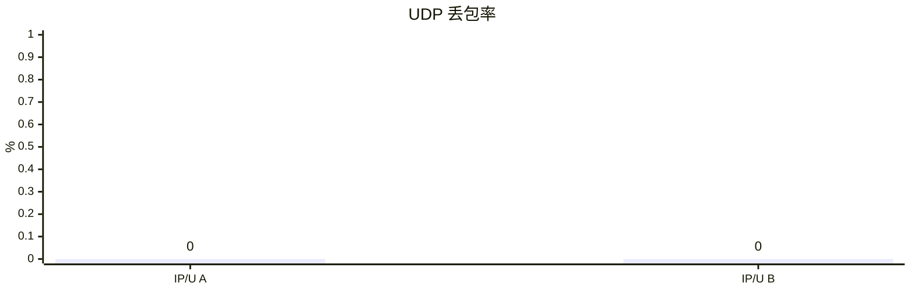

## 当前其他协议对照

A 为 Mihomo `v1.19.32`，B 为 Vole `1e12828`；真实 TUN，各三轮固定量负载。Mieru U/T、U/U分别为UDP载体承载TCP、UDP；TT2/T、TT2/U、TT3/U分别为TrustTunnel H2 TCP、H2 UDP、H3 UDP；M2IP/T、M2IP/U为MASQUE H2 IP TCP、UDP。双方42个业务样本与清理通过，Vole全部达到40MiB目标。吞吐和传输窗口CPU取中位数，RSS取生命周期最大值；UDP按实际发送包数汇总端到端丢包。

### 实际吞吐

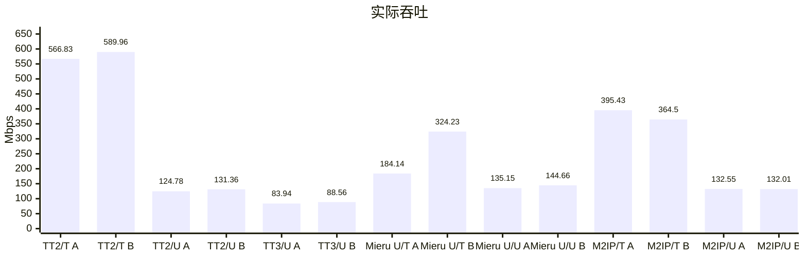

### CPU

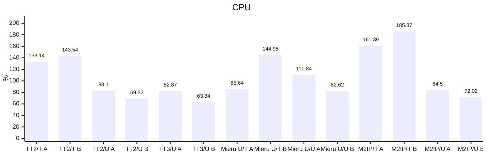

### 内存

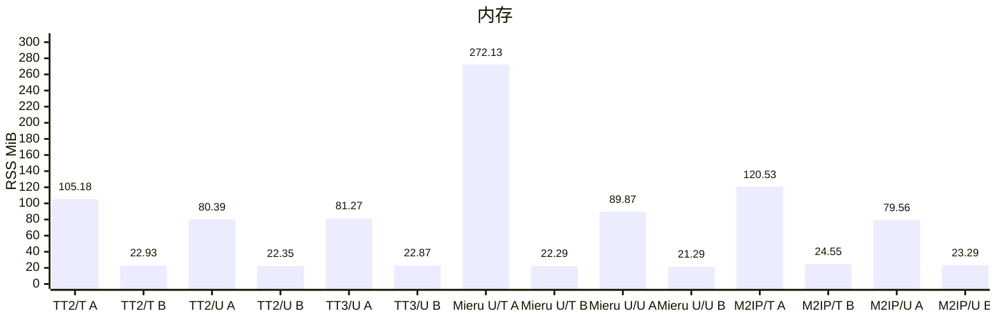

### UDP 丢包率

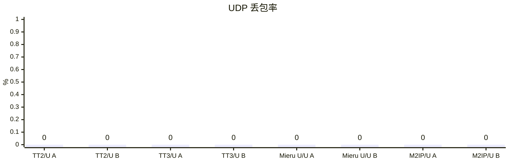

## Mieru TCP 内存优化对照

A 为优化前 Vole `f9830a9`，B 为优化后 `2d6ae1f`。两者使用同一官方 mita `3.38.1`、TCP/LOW/STANDARD，Linux ARM64 普通 Release CLI 与真实 TUN，Controller 开启。每档每版本各一次 60 秒；每容器 5 CPU / 8 GiB、NAT，64 条混合流、每个 UDP socket 64 个目标、1000 DNS QPS、完整 CN GeoData。TUN/eth0 队列均为 4096，内核普通 UDP 响应队列在 B 中为 256 项。

优化后 **1/2/3 Gbps 均通过当前硬门槛**。1 Gbps 同时达到吞吐、丢包及 40 MiB 内存目标；2/3 Gbps 峰值分别为 **41.36 / 42.05 MiB**，通过 45 MiB 硬上限，尚未达到 40 MiB 优化目标。2/3 Gbps 的吞吐和丢包只记录，未完成交付保留原始状态，不作为无错误容量排名。

各组已接收内容、来源、完整 TUN 压力窗口、进程观测和 Stop/清理有效。CPU 100% 表示一个逻辑核，内存为启动至 Stop/reap 的最大 Linux RSS，UDP 丢包按实际发送包数加权。单轮 Linux 筛选不替代重复统计或真机 Network Extension 内存验收。验收口径见[压力标准](acceptance.md)。

### 实际吞吐

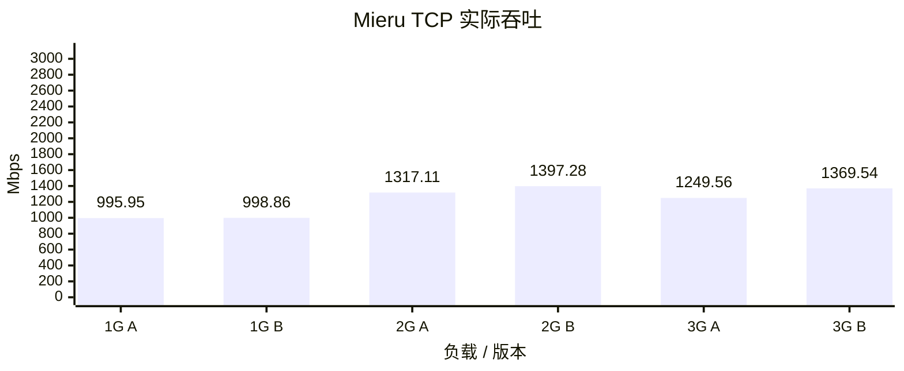

### CPU

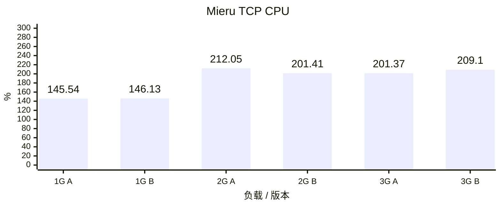

### 内存

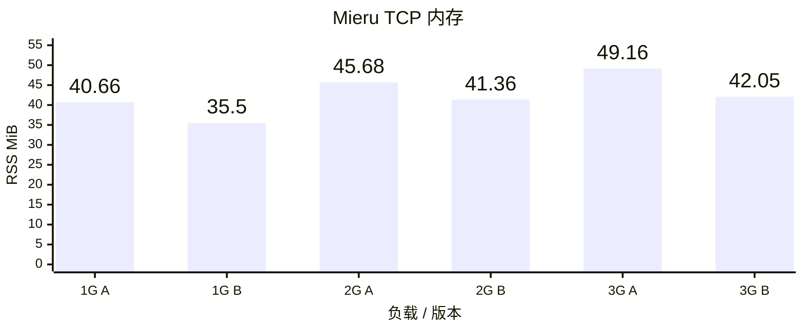

### UDP 丢包率

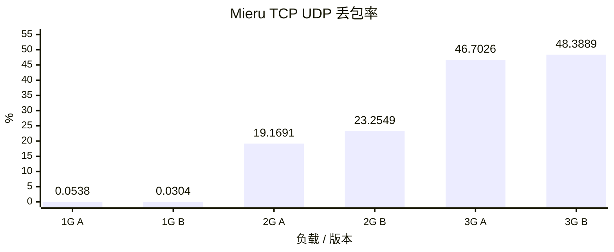

## 历史 Mieru / Mihomo 对照

Vole `c84f2ba` 与 Mihomo `1.19.32`，均连接官方 mita `3.38.1`，使用 TCP 载体、LOW 复用和 STANDARD 握手。Linux ARM64 普通 Release CLI，真实 TUN、Controller 开启；每容器 5 CPU / 8 GiB、NAT，每端每档各一次 60 秒，64 条混合 TCP/UDP 流、每个 UDP socket 64 个目标、1000 DNS QPS、完整 CN GeoData，队列和采样口径一致。

UDP 原站验证预期出口 IP，允许中继关联重建后的源端口变化，保留目标轮转、长度、内容、序号和重复包校验；客户端响应仍须来自固定原站 IP/端口。四组均未触发 UDP 来源、长度、目标、坏内容或重复包校验错误，实际输入、观察器与停止清理均通过。

**该轮仅 Vole 1 Gbps 通过压力硬门槛及 40 MiB 内存目标**，仍有容许范围内的 UDP 接收超时。其余三组数据或负载未完成；Mihomo 两档仍有独立 TCP broken-pipe / EOF，2 Gbps 两端还有发送超时及收尾超限。图中为活动窗口实际接收量，不能将未通过样本当作无错误容量或有效性能排名。2 Gbps 的吞吐数值接近，UDP 丢包仍有明显差距，不能据此确定协议上限。验收口径见[压力标准](acceptance.md)。

CPU 100% 表示一个逻辑核；内存取 CLI 从启动至 Stop 退出的最大 Linux RSS；UDP 丢包按上下行实际发送包数加权，不把漏发计入丢包。单轮 Linux 结果不替代重复统计或真机 Network Extension 内存验收。

### 实际吞吐

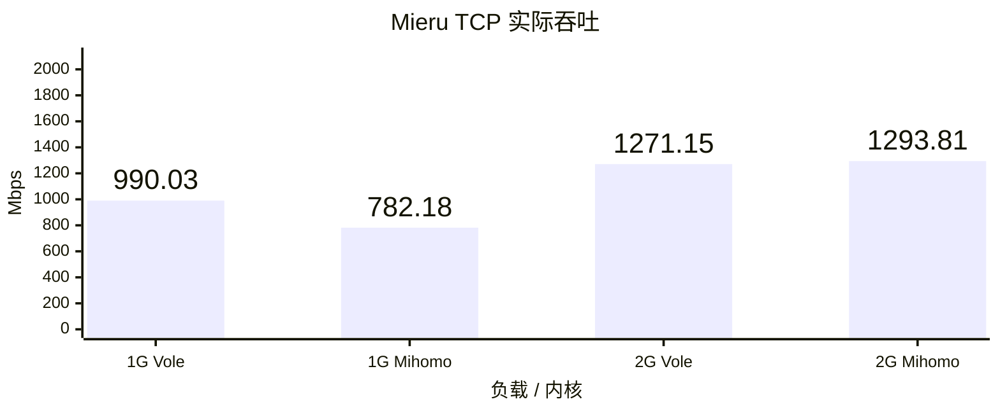

### CPU

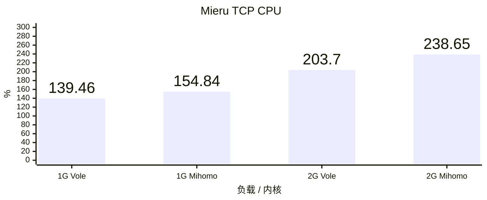

### 内存

```mermaid
---
config:
  xyChart:
    width: 850
    height: 350
    showDataLabel: true
    showDataLabelOutsideBar: true
---
xychart
    title "Mieru TCP 内存"
    x-axis "负载 / 内核" ["1G Vole", "1G Mihomo", "2G Vole", "2G Mihomo"]
    y-axis "RSS MiB" 0 --> 3000
    bar [39.63, 344.33, 53.63, 2581.21]
```

### UDP 丢包率

```mermaid
---
config:
  xyChart:
    width: 850
    height: 350
    showDataLabel: true
    showDataLabelOutsideBar: true
---
xychart
    title "Mieru TCP UDP 丢包率"
    x-axis "负载 / 内核" ["1G Vole", "1G Mihomo", "2G Vole", "2G Mihomo"]
    y-axis "%" 0 --> 25
    bar [0.0648, 0.0537, 22.2470, 6.1387]
```

## 历史 DIRECT 结果

Linux ARM64 普通 Release CLI，Vole `b58b82f` 的历史结果。A 为原默认构建，B 为原 `low-memory` 构建；源码、依赖、Ubuntu 镜像、原始 GeoData 和流量驱动一致。

每容器 5 CPU、8 GiB、NAT；每档 60 秒混合 TCP/UDP、64 条流、每个 UDP socket 64 个目标、1000 DNS QPS、完整 `geosite:cn` / `geoip:cn`，DIRECT 出口，Controller 开启且负载期间不轮询。TUN / eth0 队列均为 4096，原站队列保持默认。每档每种构建各运行三轮。

吞吐与 CPU 取三轮中位数，CPU 100% 表示一个逻辑核；内存取三轮 CLI 生命周期最大 RSS，覆盖启动、负载与 Stop 退出；UDP 丢包率合并三轮实际上下行发送包数后加权。Linux CLI RSS 用于内存优化筛选，不能替代真机 Network Extension physical footprint。

全部 12 个历史样本的 RSS 均低于 40 MiB。这些历史 DIRECT 结果不代表当前构建的 Mieru 性能。

### 实际吞吐

```mermaid
---
config:
  xyChart:
    width: 850
    height: 350
    showDataLabel: true
    showDataLabelOutsideBar: true
---
xychart
    title "实际吞吐"
    x-axis "负载 / 历史构建" ["1G A", "1G B", "2G A", "2G B"]
    y-axis "Mbps" 0 --> 2100
    bar [999.81, 999.81, 1996.48, 1997.14]
```

### CPU

```mermaid
---
config:
  xyChart:
    width: 850
    height: 350
    showDataLabel: true
    showDataLabelOutsideBar: true
---
xychart
    title "CPU"
    x-axis "负载 / 历史构建" ["1G A", "1G B", "2G A", "2G B"]
    y-axis "%" 0 --> 200
    bar [109.48, 113.15, 178.10, 181.66]
```

### 内存

```mermaid
---
config:
  xyChart:
    width: 850
    height: 350
    showDataLabel: true
    showDataLabelOutsideBar: true
---
xychart
    title "内存"
    x-axis "负载 / 历史构建" ["1G A", "1G B", "2G A", "2G B"]
    y-axis "RSS MiB" 0 --> 50
    bar [32.82, 28.89, 39.13, 36.17]
```

### UDP 丢包率

```mermaid
---
config:
  xyChart:
    width: 850
    height: 350
    showDataLabel: true
    showDataLabelOutsideBar: true
---
xychart
    title "UDP 丢包率"
    x-axis "负载 / 历史构建" ["1G A", "1G B", "2G A", "2G B"]
    y-axis "%" 0 --> 0.5
    bar [0.0000, 0.0000, 0.0505, 0.0613]
```
