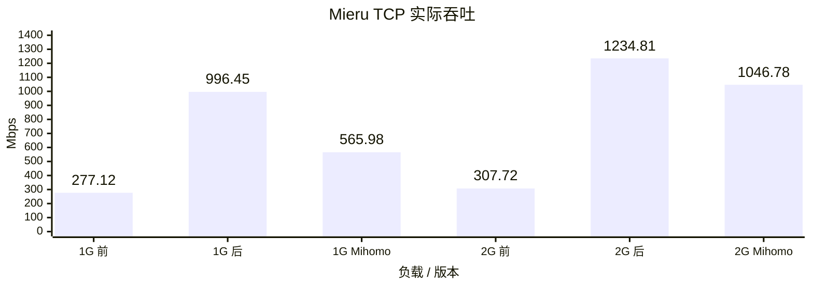
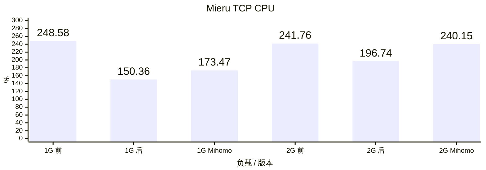
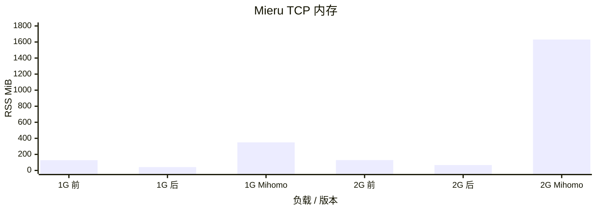
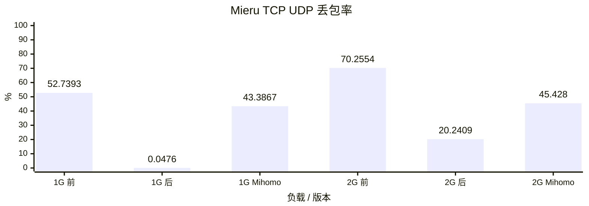
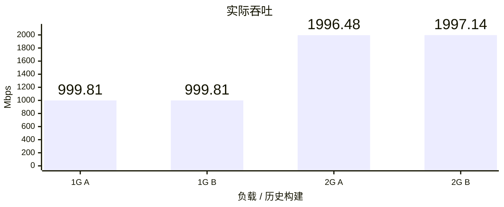
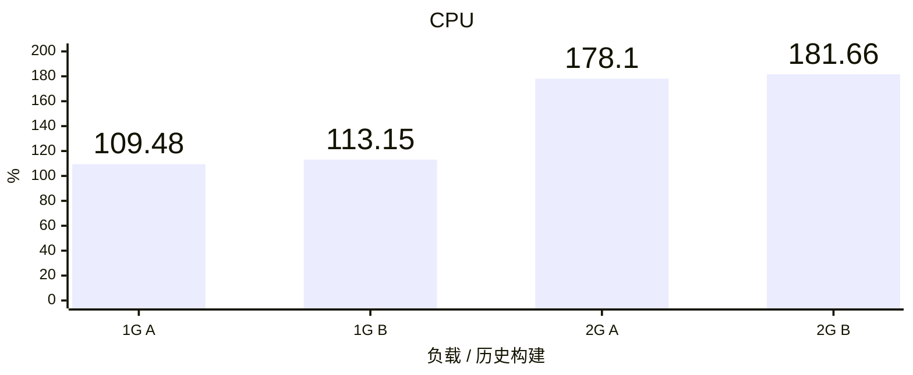
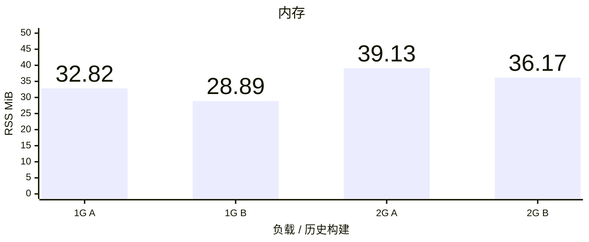
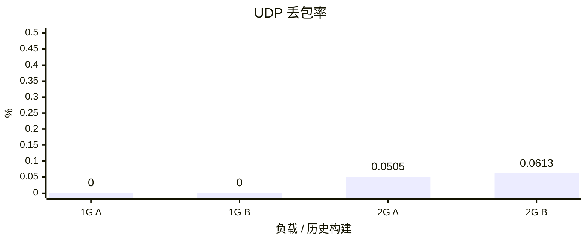

# Vole TUN benchmark

## Mieru TCP 载体

Vole 优化前 `e9d64b9`、优化后 `c84f2ba`，参考端 Mihomo `1.19.32`，均连接官方 mita `3.38.1`，使用 TCP 载体、LOW 复用和 STANDARD 握手。Linux ARM64 普通 Release CLI，真实 TUN、Controller 开启；每档各一次 60 秒，64 条混合 TCP/UDP 流、每个 UDP socket 64 个目标、1000 DNS QPS、完整 CN GeoData。规则、流量驱动、队列和采样口径固定。

**优化后 1 Gbps 样本通过压力硬门槛**：接收 996.45 Mbps、RSS 41.48 MiB、UDP 丢包 0.0476%，尚未达到 40 MiB 内存目标。32 条 UDP 流的接收超时仍保留，`driver_complete=false`，按既有丢包容限判定；数据有效、DNS、Stop 和清理通过。优化后 2 Gbps 仍未达标：接收 1234.81 Mbps、RSS 67.19 MiB、UDP 丢包 20.2409%。统一验收标准见[压力标准](acceptance.md)。

其余五个样本均未通过压力验收。Mihomo 两档均出现 `datagram-source-or-size`，接收提前终止；对应丢包包含接收终止后的未收到包，无法据此判断协议吞吐上限或作有效性能排名。优化前及优化后 2 Gbps 也保留未完成流和负载校验失败；图中仍如实列出活动窗口接收计数。

CPU 100% 表示一个逻辑核；内存取 CLI 从启动至 Stop 退出的最大 Linux RSS；UDP 丢包按实际上下行发送包数加权。以下为单轮 Linux 结果，不能替代重复统计或真机 Network Extension 内存验收。

### 实际吞吐

### CPU

### 内存

### UDP 丢包率

## 历史 DIRECT 结果

Linux ARM64 普通 Release CLI，Vole `b58b82f` 的历史结果。A 为原默认构建，B 为原 `low-memory` 构建；源码、依赖、Ubuntu 镜像、原始 GeoData 和流量驱动一致。

每容器 5 CPU、8 GiB、NAT；每档 60 秒混合 TCP/UDP、64 条流、每个 UDP socket 64 个目标、1000 DNS QPS、完整 `geosite:cn` / `geoip:cn`，DIRECT 出口，Controller 开启且负载期间不轮询。TUN / eth0 队列均为 4096，原站队列保持默认。每档每种构建各运行三轮。

吞吐与 CPU 取三轮中位数，CPU 100% 表示一个逻辑核；内存取三轮 CLI 生命周期最大 RSS，覆盖启动、负载与 Stop 退出；UDP 丢包率合并三轮实际上下行发送包数后加权。Linux CLI RSS 用于内存优化筛选，不能替代真机 Network Extension physical footprint。

全部 12 个历史样本的 RSS 均低于 40 MiB。这些历史 DIRECT 结果不代表当前构建的 Mieru 性能。

### 实际吞吐

### CPU

### 内存

### UDP 丢包率

