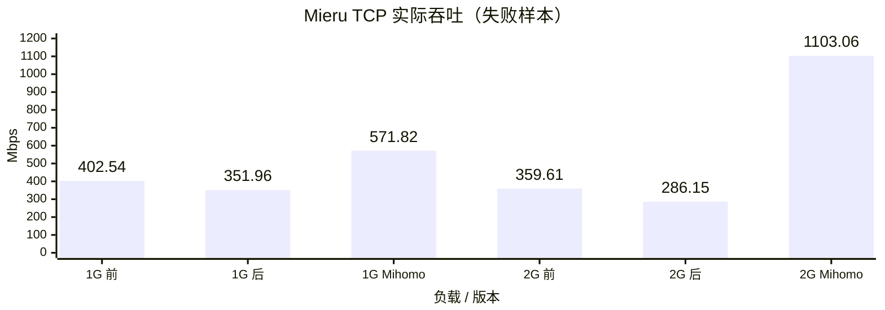
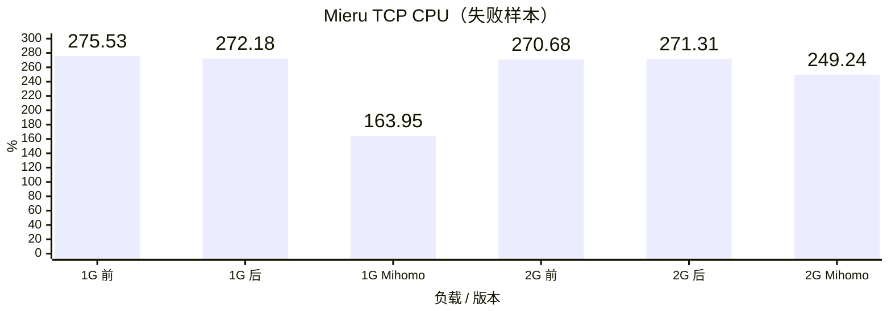
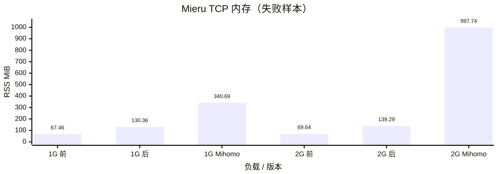
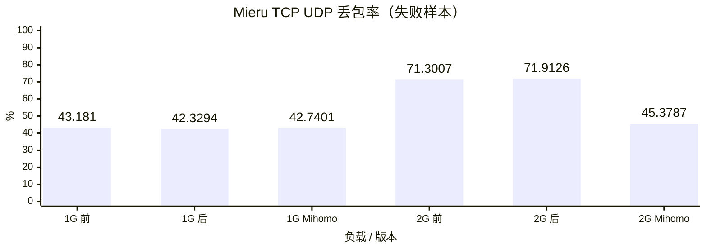
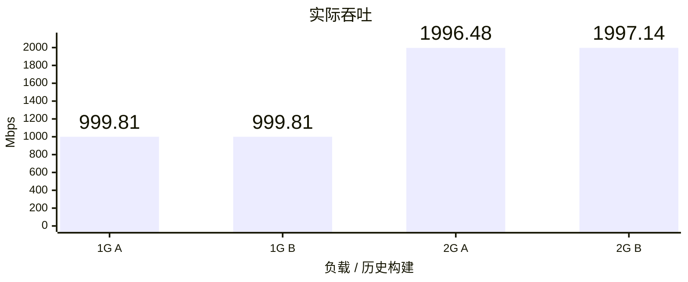
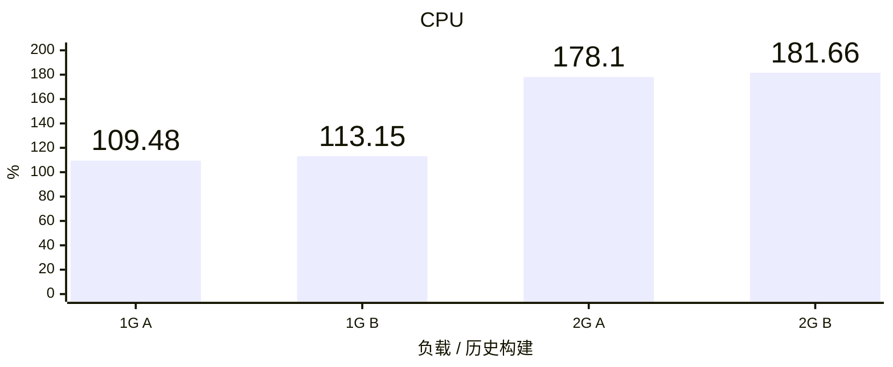
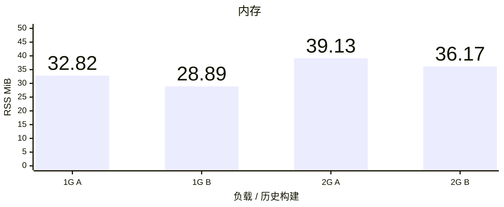
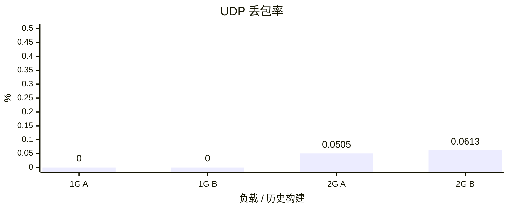

# Vole TUN benchmark

## Mieru TCP 载体

修改前为 Vole `b7005d9`，修改后为 `e9d64b9`，参考端为 Mihomo `1.19.32`；出站连接官方 mita `3.38.1`，使用 TCP 载体、LOW 复用和 STANDARD 握手。Linux ARM64 普通 Release CLI，真实 raw-IP TUN，每容器 5 CPU、8 GiB、NAT。

每档 60 秒混合 TCP/UDP、64 条流、每个 UDP socket 64 个目标、1000 DNS QPS、完整 `geosite:cn` / `geoip:cn`；Controller 开启且负载期间不轮询，TUN / eth0 队列均为 4096。业务经过 Mieru，DNS 保持独立的 DIRECT 路径。三个版本在 1 / 2 Gbps 每档各测一次，构建、规则、流量驱动和采样口径固定。

**六个样本均未通过压力验收，数据传输不完整，负载也未达到目标。** 图中吞吐仅为失败样本在活动窗口内统计的接收速率，不能作为达标吞吐或性能排名。Mihomo 两档另外记录了 `datagram-source-or-size` 合并错误分类，尚未区分具体原因；丢包数字包含该错误使接收提前终止后的未收到包，不能全归因于网络拥塞。

CPU 100% 表示一个逻辑核；内存为 CLI 从启动至 Stop 退出期间的最大 Linux RSS；UDP 丢包率按实际上下行发送包数加权。这是单轮 Linux 筛选，不能替代三轮统计或真机 Network Extension physical footprint。

本轮修改后，1 / 2 Gbps 下的接收速率分别下降 12.6% / 20.4%，RSS 分别增加 93.3% / 100.0%。CPU 未显示可确认的效率改善，UDP 丢包仍远超 0.5%；Vole 两个版本的 RSS 均超过 45 MiB 硬上限，未满足 40 MiB 优化目标。此前慢读延迟改善不代表高负载性能通过。验收口径见[压力标准](acceptance.md)。

### 实际吞吐

### CPU

### 内存

### UDP 丢包率

## 历史 DIRECT 结果

Linux ARM64 普通 Release CLI，Vole `b58b82f` 的历史结果。A 为原默认构建，B 为原 `low-memory` 构建；源码、依赖、Ubuntu 镜像、原始 GeoData 和流量驱动一致。

每容器 5 CPU、8 GiB、NAT；每档 60 秒混合 TCP/UDP、64 条流、每个 UDP socket 64 个目标、1000 DNS QPS、完整 `geosite:cn` / `geoip:cn`，DIRECT 出口，Controller 开启且负载期间不轮询。TUN / eth0 队列均为 4096，原站队列保持默认。每档每种构建各运行三轮。

吞吐与 CPU 取三轮中位数，CPU 100% 表示一个逻辑核；内存取三轮 CLI 生命周期最大 RSS，覆盖启动、负载与 Stop 退出；UDP 丢包率合并三轮实际上下行发送包数后加权。Linux CLI RSS 用于内存优化筛选，不能替代真机 Network Extension physical footprint。

全部 12 个历史样本的 RSS 均低于 40 MiB。这些历史 DIRECT 结果不代表当前构建的 Mieru 性能。

### 实际吞吐

### CPU

### 内存

### UDP 丢包率

