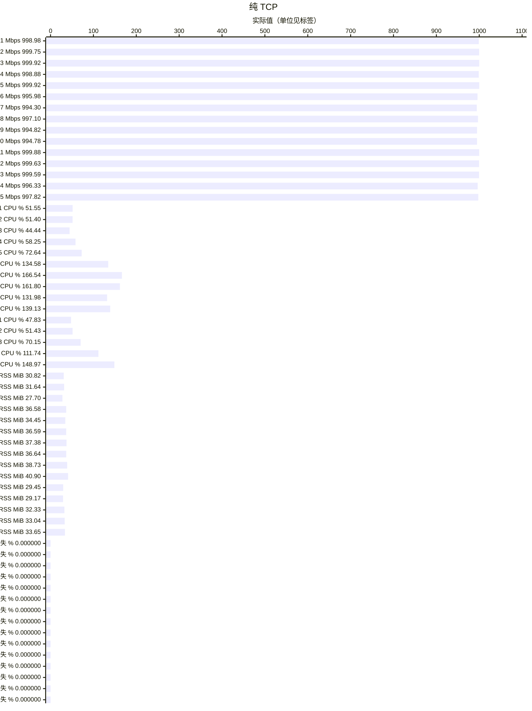
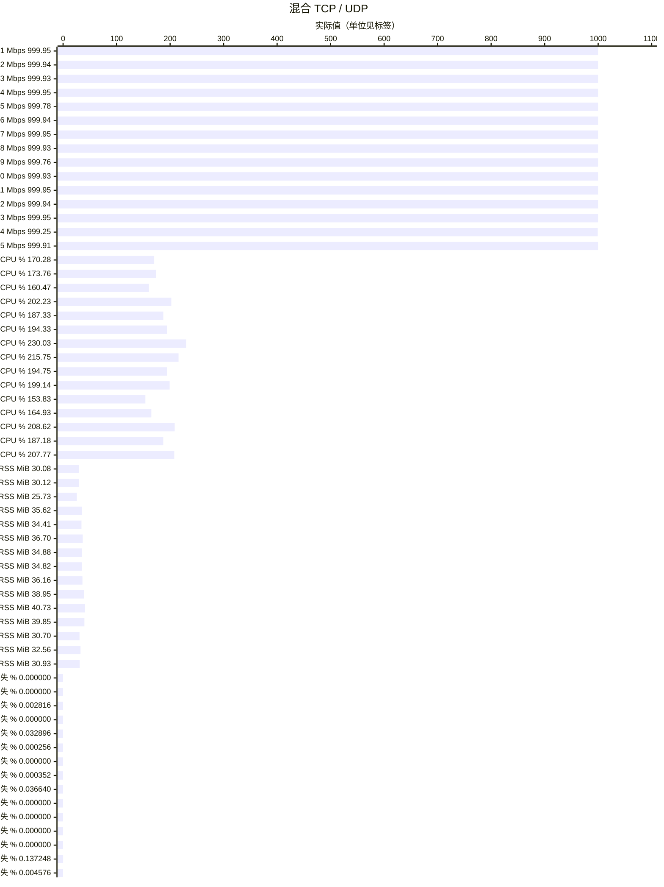
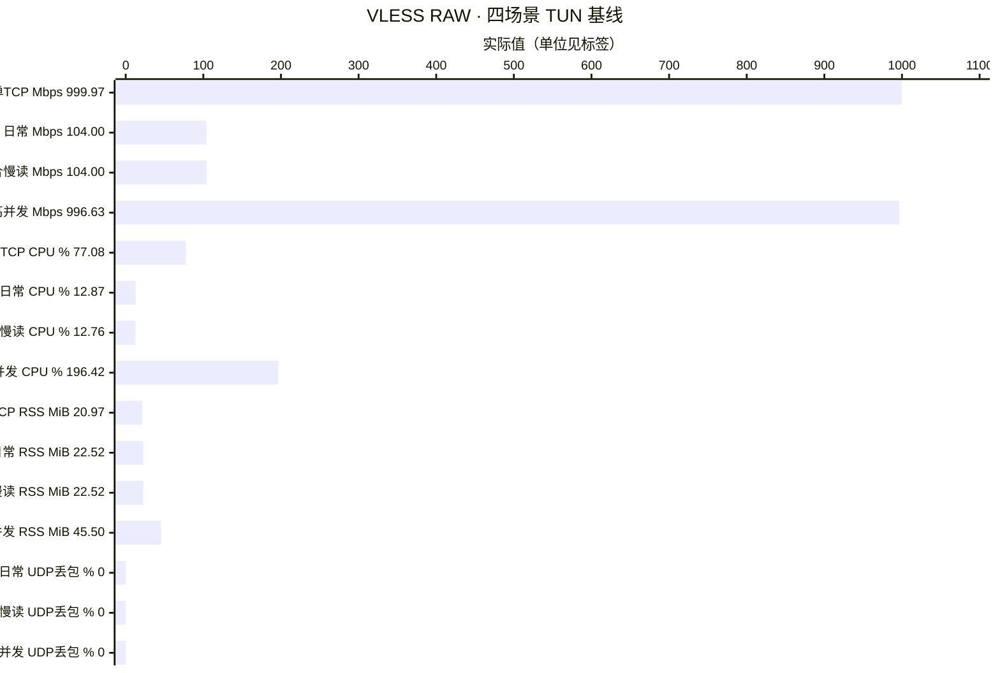

# Vole TUN benchmark

**1 Gbps**、真实 TUN、Controller 开启、完整 CN GeoData；Linux ARM64 普通 Release，每容器 5 CPU / 8 GiB。64 条业务流，每个 UDP socket 轮换 64 个目标，VLESS RAW 为单目标；各窗口 60 秒、1000 DNS QPS。

1 Gbps 要求吞吐 ≥990 Mbps、RSS ≤43 MiB、UDP 丢包率 ≤0.2%；纯 TCP 要求计划字节、校验和及结束状态完整。

每图依次列出实际吞吐、CPU、峰值 RSS 和丢失率。CPU 为含准备与收尾的进程平均值，100% 表示一个逻辑核；RSS 覆盖启动至 Stop/reap；不同单位仅在同类指标内比较。纯 TCP 按业务完整交付验收，本表所有 1 Gbps TCP 窗口均完整；重传单独记录。UDP 和混合流显示上下行实际发送包数加权的 UDP 丢包率。

| 代号 | 组合 |
| --- | --- |
| P01 | `vless-tcp-tls` |
| P02 | `vless-vision-reality` |
| P03 | `vless-tcp-none` |
| P04 | `vless-xhttp-h1-tls-stream-up` |
| P05 | `vless-xhttp-h1-tls-stream-one` |
| P06 | `vless-xhttp-h2-tls-stream-up` |
| P07 | `vless-xray-xhttp-h3-stream-up` |
| P08 | `vless-xray-xhttp-h3-stream-one` |
| P09 | `vless-xhttp-h2-tls-stream-up-download` |
| P10 | `vless-xray-xhttp-h3-packet-up-download` |
| P11 | `2022-blake3-aes-256-gcm` |
| P12 | `2022-blake3-chacha20-poly1305` |
| P13 | `2022-blake3-aes-256-gcm-shadowtls-v3-uot-v2` |
| P14 | `hysteria2` |
| P15 | `hysteria2-native-brutal-salamander` |

图表汇总各项最近一次已验收结果：保留未受影响的先前通过窗口，修复后对受影响路径复验；并非所有组合均由同一二进制重新跑完整矩阵。保留的早期窗口与复验窗口的完整 CN 快照、对端 UDP 默认缓冲存在差异；复验对端使用 2 MiB UDP 默认接收缓冲，origin 保持默认。汇总不用于计算严格同输入的前后性能增幅。Hysteria2 自动模式使用 CUBIC，显式带宽模式使用 Brutal。

## 体验与高并发

VLESS RAW、完整 CN GeoSite 与 MetaDB、Controller 空闲，四窗各运行 60 秒。
均使用单源 IP，每条 UDP 一个目标；业务连接数由实际五元组核对。
单 TCP 提供 1 Gbps，记录单流容量；日常与混合慢读各保持 32 TCP + 32 UDP，
执行约 104 Mbps 的有限任务，不套用 990 Mbps 容量门槛。
混合慢读只将 4 条对照 TCP 的中段任务限制为每条 128 KiB/s，随后恢复正常读取。
高并发保持 256 TCP + 256 UDP 持续活跃，提供 1 Gbps。

单 TCP 的 UDP 丢包为 N/A，不画成零。日常与混合慢读均完整交付全部 372 个任务，
前三窗背景 DNS 均为 1200/1200；所有 TCP 字节与校验和完整，正常 Stop/reap 和 TUN 清理有效。

高并发全部 512 条连接准备成功；512 次准备 DNS 查询共尝试发送 541 次，29 次在重发后成功。
背景 DNS 计划 60000 次、跳过 8 次，实际发送 59992 次全部成功；保留原始 `driver_complete=false`。
业务数据有效、TCP 完整交付、UDP 丢包为零，吞吐达到 990 Mbps；
生命周期 RSS 45.50 MiB 仍超过 43 MiB，整体压力验收未通过。

历史有效高并发结果仍保留：`c66757b` 为 51.78 MiB，`d96ffe8` 有界按需分配版本为 46.70 MiB，
均未达到 43 MiB。此前连接准备失败的窗口未形成完整负载，不用于比较内存收益。
本轮 Core 仅补充既有 DNS 回复队列首次丢弃的数值日志；负载器仅在原 5 秒 DNS 交换期限内增加一次有限重发，
未改变 Core 缓冲、队列、allocator 或压力 DNS，不将本轮数值变化归为 Core 内存优化。

以上为 Linux RSS 压力筛选，不代替 iOS/tvOS 整个 VPN 扩展的 physical footprint 验收，见[验收边界](acceptance.md)。
