# Vole TUN benchmark

## 当前 DIRECT 定速对照

A 为 Mihomo `v1.19.32`，B 为 Vole `1e12828`；Linux ARM64 普通 Release、真实 TUN、Controller、完整 CN GeoData。每档每端三轮、每轮60秒；吞吐和CPU取中位数，RSS取生命周期最大值，UDP丢包按三轮上下行实际发送包数加权。CPU 100%表示一个逻辑核。

Vole 九个窗口均通过现行硬门槛及40MiB目标。2/3Gbps存在超时和未完成流，吞吐为活动窗口已收有效载荷，不代表无错误容量；验收口径见[压力标准](acceptance.md)。

### 实际吞吐

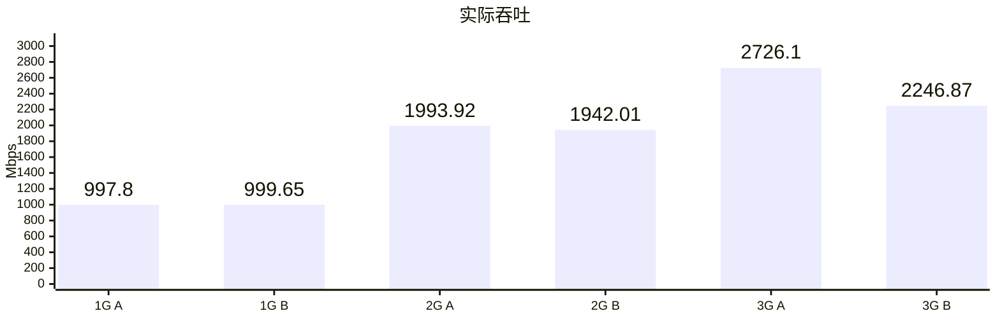

### CPU

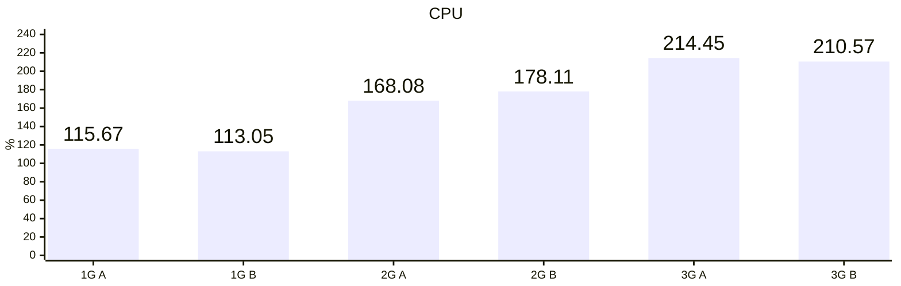

### 内存

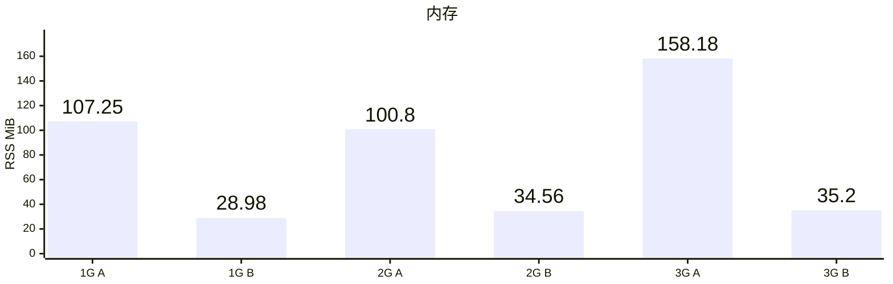

### UDP 丢包率

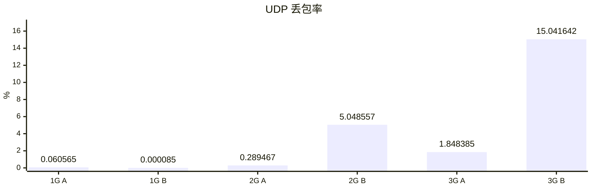

## 当前 H3 对照

A 为 Vole `c42eba7`，B 为 `1e12828`；真实 TUN，各三轮固定量负载。吞吐和传输窗口CPU取中位数，RSS取生命周期最大值；DoH单列QPS，UDP为端到端交付丢包率。

L4、IP/T、IP/U分别表示MASQUE L4、IP TCP、IP UDP；TT为TrustTunnel。

九项业务与清理通过，B全部达到40MiB目标；旧相对判据保留7 PASS、2 FAIL。MASQUE L4吞吐下降约3.10%、RSS从29.09降至26.50MiB（降低8.90%）；IP UDP吞吐下降约0.66%、RSS从23.31降至23.05MiB（降低1.11%）。

旧相对规则要求吞吐与内存同时改善，或一项改善超过2%、另一项退步小于1%。L4因吞吐退步超过1%、IP UDP因内存改善不足2%而保留原始`PERFORMANCE_FAIL`，不追溯改签。

按[现行内存优先标准](acceptance.md#性能采纳标准)，两项在已测固定量TUN场景下均达到40MiB目标，内存改善可渐进采纳；接受上述取舍，不再作为阶段14阻塞项，也不再专项优化。吞吐、CPU和丢包率保留实测结果。

固定量结果不代签MASQUE各模式的1Gbps定速吞吐及丢包门槛，也不代签2/3Gbps内存过载验收；Linux RSS不替代iOS/tvOS整个VPN扩展的physical footprint验收。

### 实际吞吐 TCP

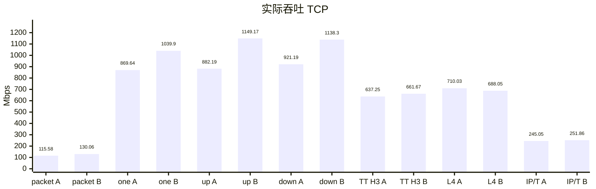

### 实际吞吐 UDP

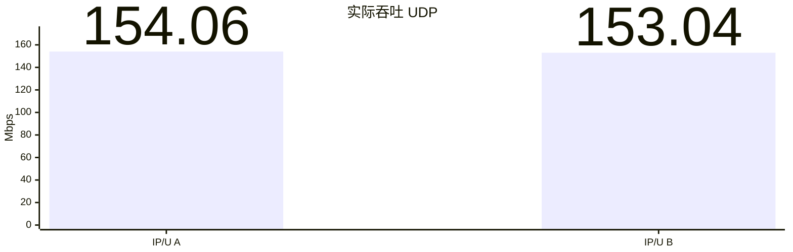

### 实际吞吐 DoH

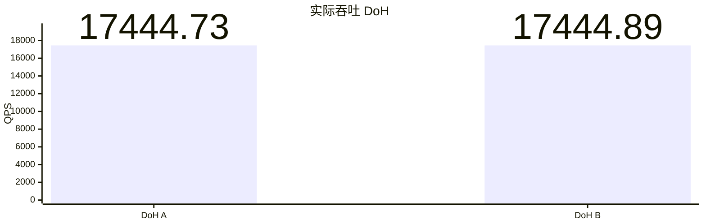

### CPU

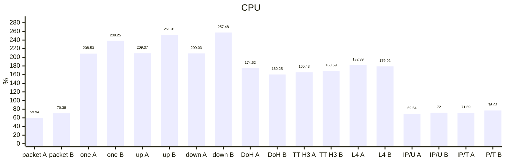

### 内存

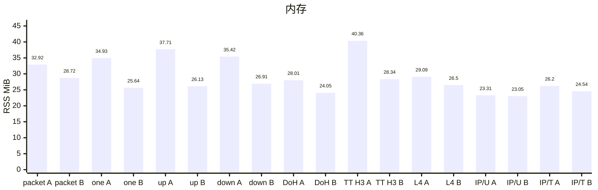

### UDP 丢包率

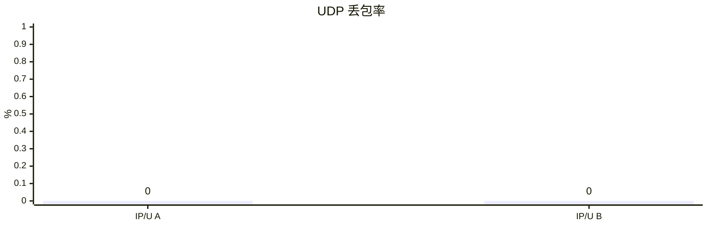

## 当前其他协议对照

A 为 Mihomo `v1.19.32`，B 为 Vole `1e12828`；真实 TUN，各三轮固定量负载。Mieru U/T、U/U分别为UDP载体承载TCP、UDP；TT2/T、TT2/U、TT3/U分别为TrustTunnel H2 TCP、H2 UDP、H3 UDP；M2IP/T、M2IP/U为MASQUE H2 IP TCP、UDP。双方42个业务样本与清理通过，Vole全部达到40MiB目标。吞吐和传输窗口CPU取中位数，RSS取生命周期最大值；UDP按实际发送包数汇总端到端丢包。

### 实际吞吐

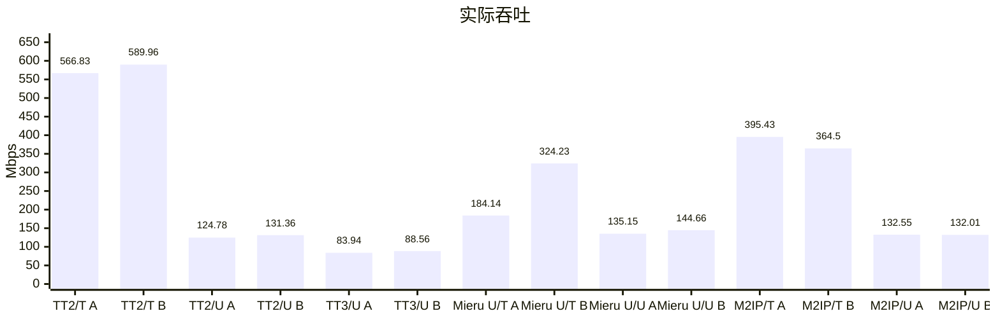

### CPU

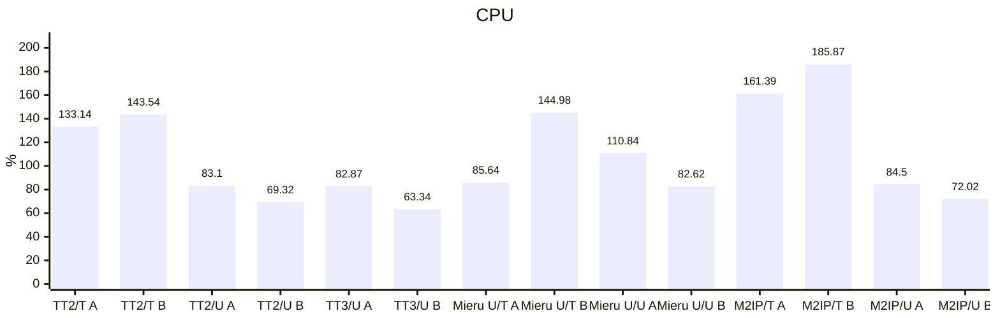

### 内存

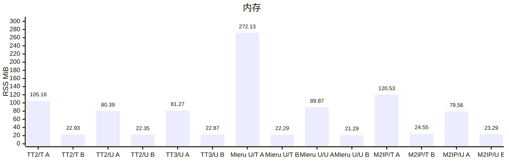

### UDP 丢包率

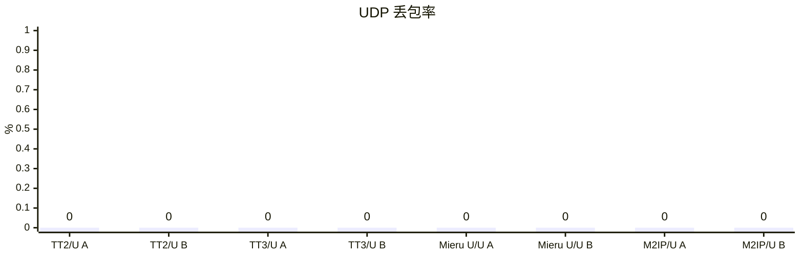

## Mieru TCP 载体定速结果

Vole `2d6ae1f` 的普通 CLI 与受验源码 `1e12828` 的对应产物字节相同，复用本组最终结果。官方 mita `3.38.1`、TCP/LOW/STANDARD，Linux ARM64 普通 Release CLI、真实 TUN、Controller 开启。每档一次60秒；每容器5 CPU / 8 GiB、NAT，64条混合流、每UDP socket 64个目标、1000 DNS QPS、完整CN GeoData。TUN/eth0队列均为4096。

**1/2/3 Gbps 均通过当前硬门槛**。1 Gbps 同时达到吞吐、丢包及 40 MiB 内存目标；2/3 Gbps 峰值分别为 **41.36 / 42.05 MiB**，通过 45 MiB 硬上限，尚未达到 40 MiB 优化目标；本项不再专项优化。2/3 Gbps 的吞吐和丢包只记录，未完成交付保留原始状态，不作为无错误容量排名。

各组已接收内容、来源、完整 TUN 压力窗口、进程观测和 Stop/清理有效。CPU 100% 表示一个逻辑核，内存为启动至 Stop/reap 的最大 Linux RSS，UDP 丢包按实际发送包数加权。单轮 Linux 筛选不替代重复统计或真机 Network Extension 内存验收。验收口径见[压力标准](acceptance.md)。

### 实际吞吐

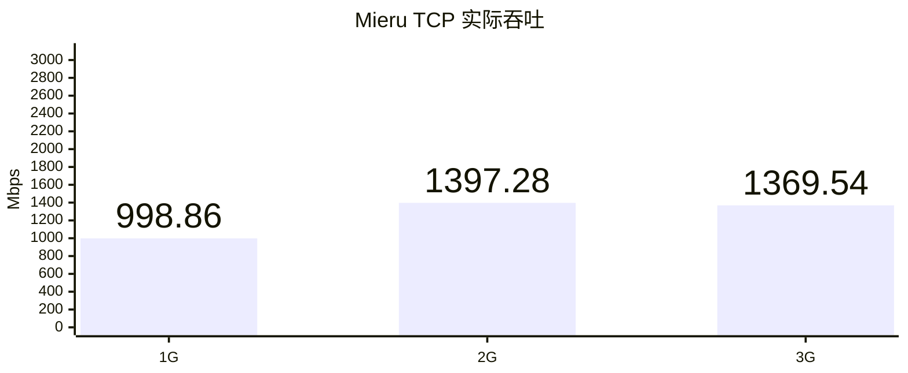

### CPU

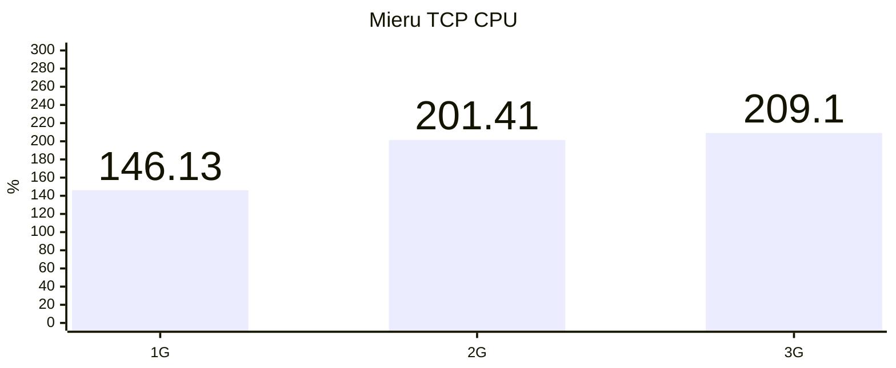

### 内存

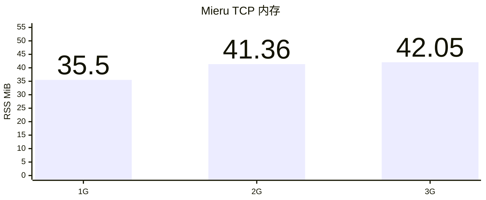

### UDP 丢包率

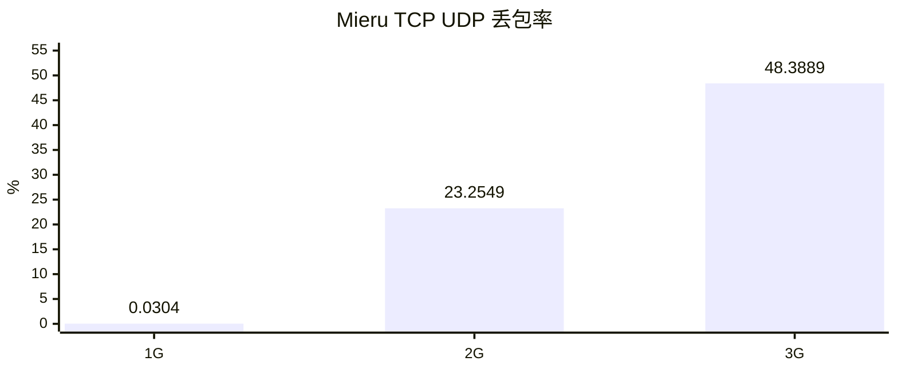
