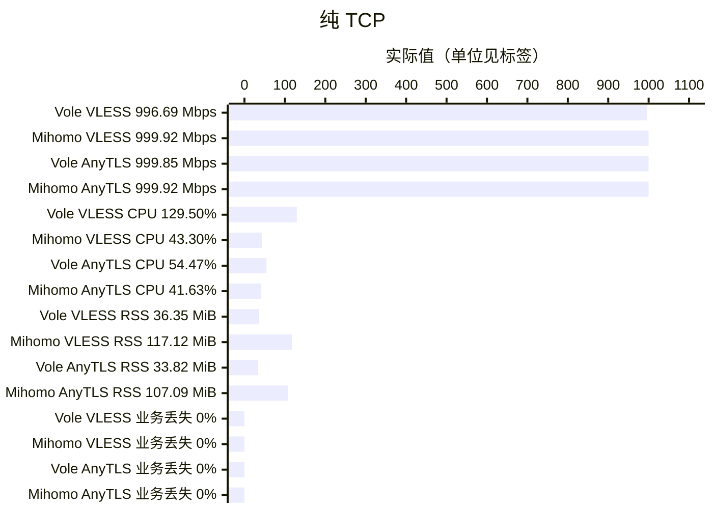
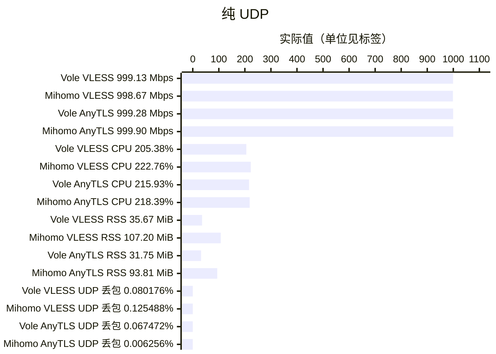
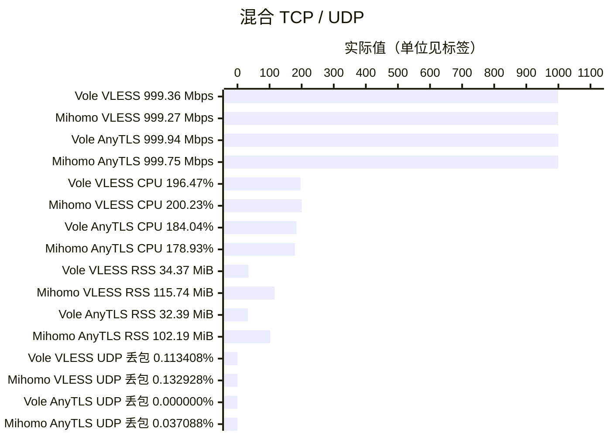

# Vole TUN benchmark

**1 Gbps**、真实 TUN、Controller 开启、完整 CN GeoData；Linux ARM64 Release，每容器 5 CPU / 8 GiB。64 条业务流，每个 UDP socket 轮换 64 个目标；各口径单轮 60 秒。

Vole `5054c29`，Mihomo `v1.19.32`。图中 VLESS 为 **VLESS + XHTTP（H2、stream-one）+ REALITY**，AnyTLS 为独立出站。

每图依次列出实际吞吐、CPU、峰值 RSS 和丢失率；标签保留实测值，各指标只在同一单位内比较。CPU 100% 表示一个逻辑核；RSS 覆盖启动至 Stop/reap。

纯 TCP 的业务丢失率按实际发送/接收字节计算，双方所有流字节、校验和及结束状态均完整；TCP 重传另记，不作为业务丢失。纯 UDP 与混合流显示按实际发送包数加权的 UDP 丢包率。

以上为单轮 Linux 实测，不代替 iOS/tvOS 整个 VPN 扩展的 physical footprint 验收，见[验收边界](acceptance.md)。
