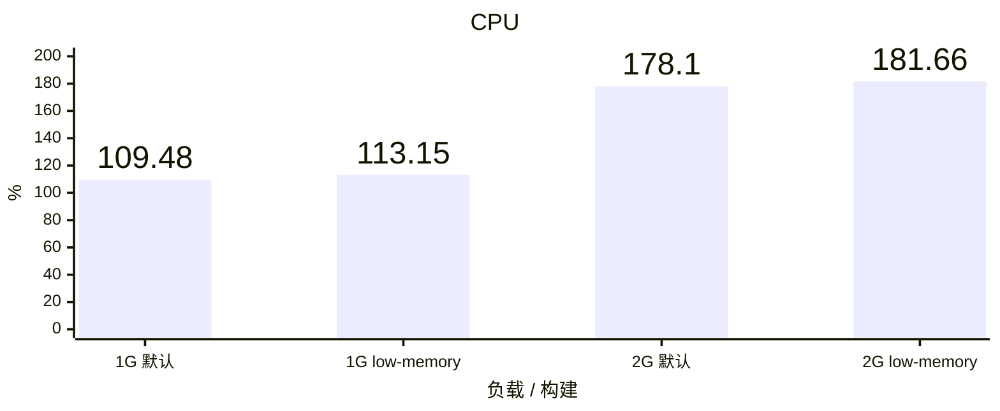
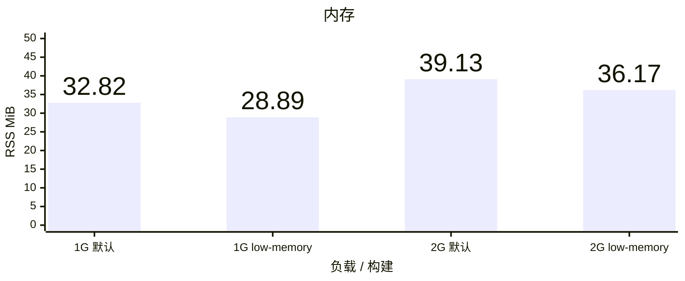
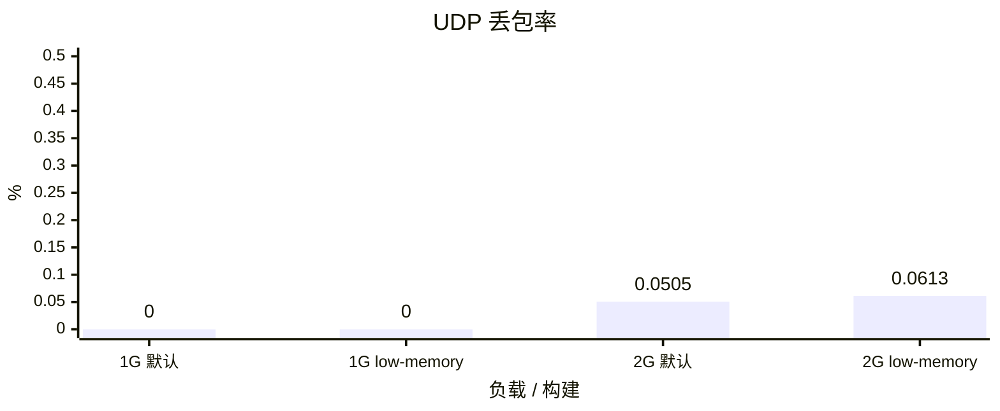

# Vole TUN benchmark

Linux ARM64 普通 Release CLI，Vole `b58b82f`。默认构建使用 `cli`，低内存构建使用 `cli,low-memory`；源码、依赖、Ubuntu 镜像、原始 GeoData 和流量驱动一致。

每容器 5 CPU、8 GiB、NAT；每档 60 秒混合 TCP/UDP、64 条流、每个 UDP socket 64 个目标、1000 DNS QPS、完整 `geosite:cn` / `geoip:cn`，DIRECT 出口，Controller 开启且负载期间不轮询。TUN / eth0 队列均为 4096，原站队列保持默认。每档每种构建各运行三轮。

吞吐与 CPU 取三轮中位数，CPU 100% 表示一个逻辑核；内存取三轮 CLI 生命周期最大 RSS，覆盖启动、负载与 Stop 退出；UDP 丢包率合并三轮实际上下行发送包数后加权。Linux CLI RSS 用于内存优化筛选，不能替代真机 Network Extension physical footprint。

全部 12 个样本通过[压力硬门槛](acceptance.md)。低内存 1 Gbps 三轮均达到 35 MiB 软目标；低内存 2 Gbps 仅一轮达到，三轮最大 RSS 为 36.17 MiB，仍满足低于 45 MiB 的硬门槛。默认构建不适用 35 MiB 软目标。

## 实际吞吐

## CPU

## 内存

## UDP 丢包率

