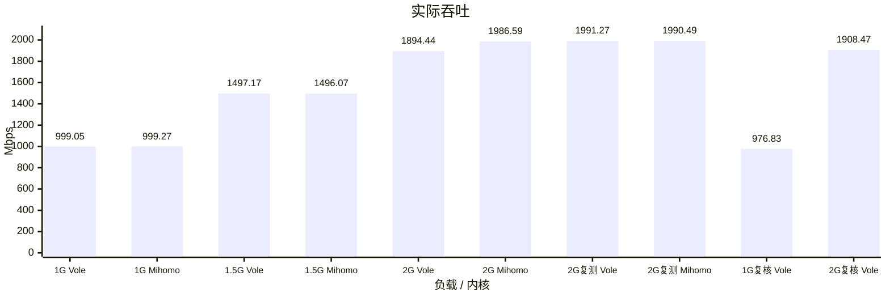
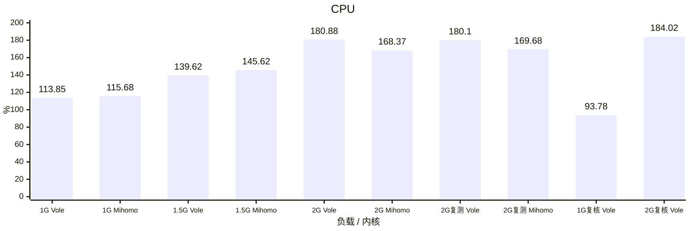
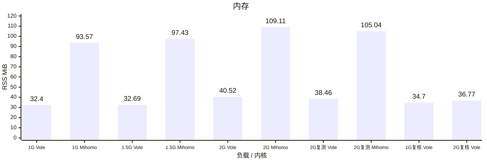
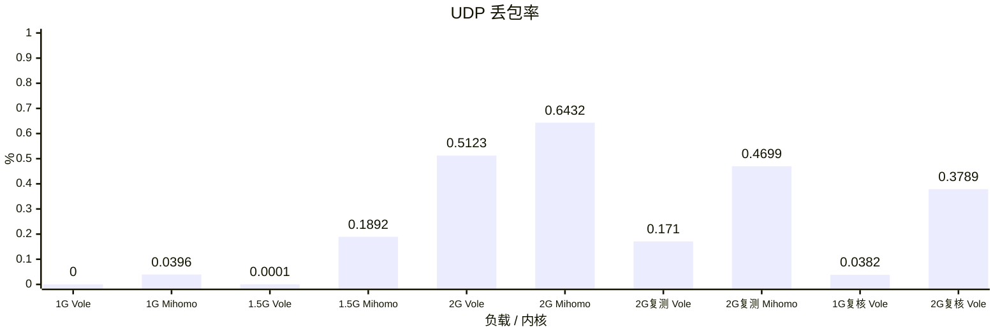
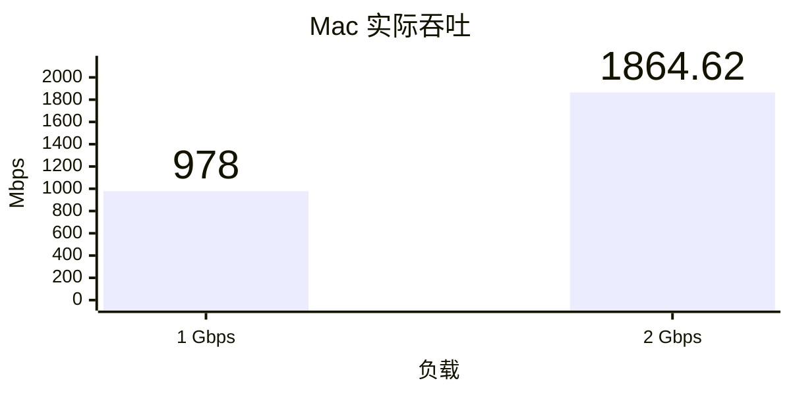
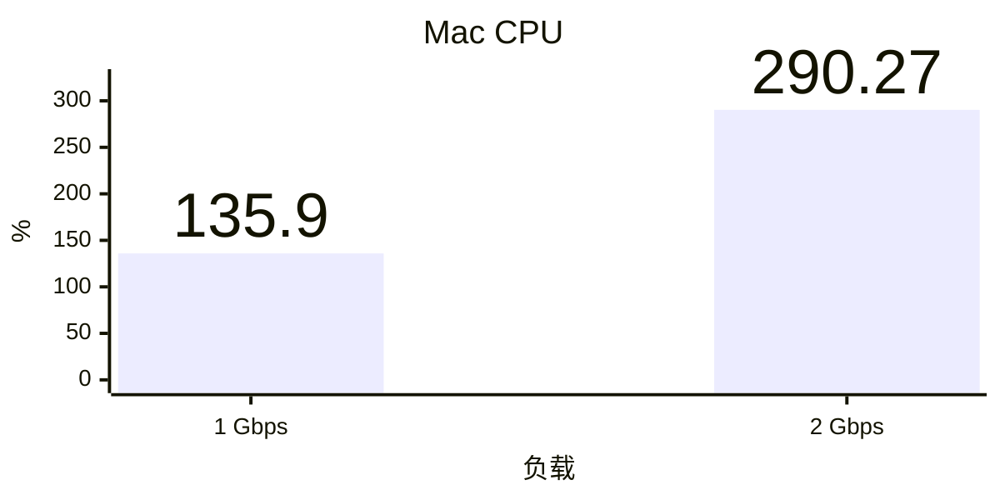
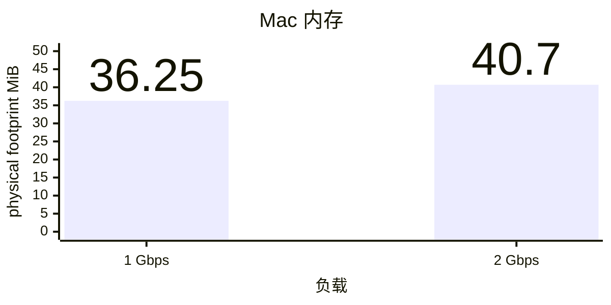
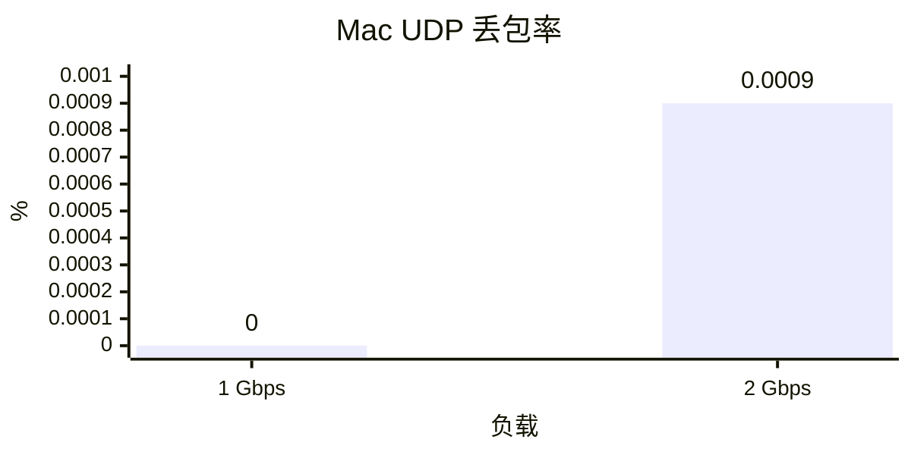

# Vole / Mihomo TUN benchmark

CPU 100% 表示一个逻辑核；UDP 丢包按实际上下行发送包数加权。

## Linux 原生 TUN

容器各 5 CPU、8 GiB；60 秒混合 TCP/UDP、64 条流、1000 DNS QPS，完整 `geosite:cn` / `geoip:cn`，DIRECT 出口，Controller 开启。内存为 CLI 生命周期观测峰值 RSS。

历史横向对照：Vole `96b665a`、Mihomo `v1.19.32`。本轮复核只运行 Vole `1d569ee`，运行时代码为 `7fbb5f4`，保留原 Linux 负载与观察器。

本轮两档均未通过压力验收：1 Gbps 的 UDP 流未完整完成，实际吞吐低于 990 Mbps；2 Gbps 实际吞吐低于 1980 Mbps。两档内存、UDP 丢包率、DNS 和正常退出检查满足本轮门槛。失败测量列入图中，不作为有效性能胜出样本。

### 实际吞吐

### CPU

### 内存

### UDP 丢包率

## macOS 模拟 TUN（历史失败结果）

Vole `1d569ee`，运行时代码为 `7fbb5f4`；60 秒、32 条双向 TCP echo 与 32 条 UDP echo、1000 DNS QPS，完整 CN GeoData、DIRECT 和 Controller。原站位于同规格 Linux 容器，Mac 运行普通 CLI 与独立负载客户端。实际吞吐为活动窗口内经内容校验的 echo 有效载荷乘二；内存为每 20 ms 采样的最大当前 physical footprint，不与 Linux RSS 混合排名。

### 实际吞吐

### CPU

### 内存

### UDP 丢包率

两档均未通过压力验收：实际吞吐与 DNS 完成不足，1 Gbps 还存在 TCP 关闭未完整完成。Mac 模拟测试工具已删除，正式压力使用 Linux；这些采样结果不能证明 iOS/tvOS Network Extension 的真机内存达标。
