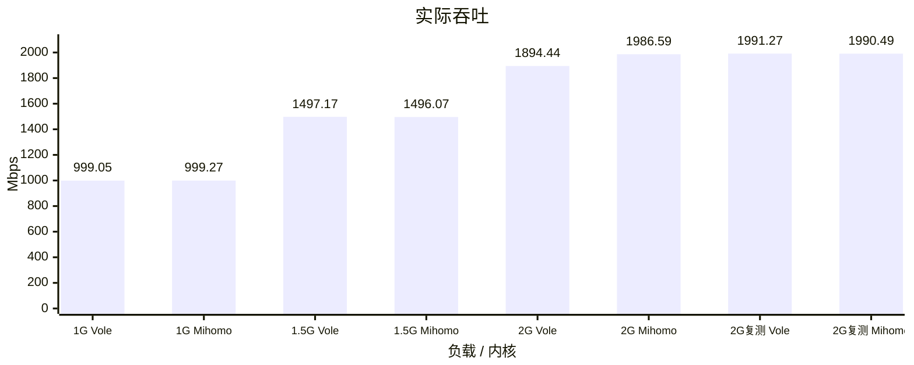
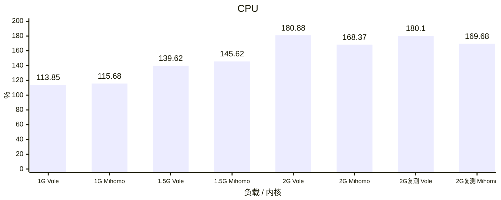
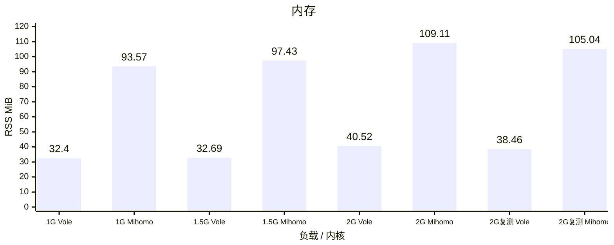
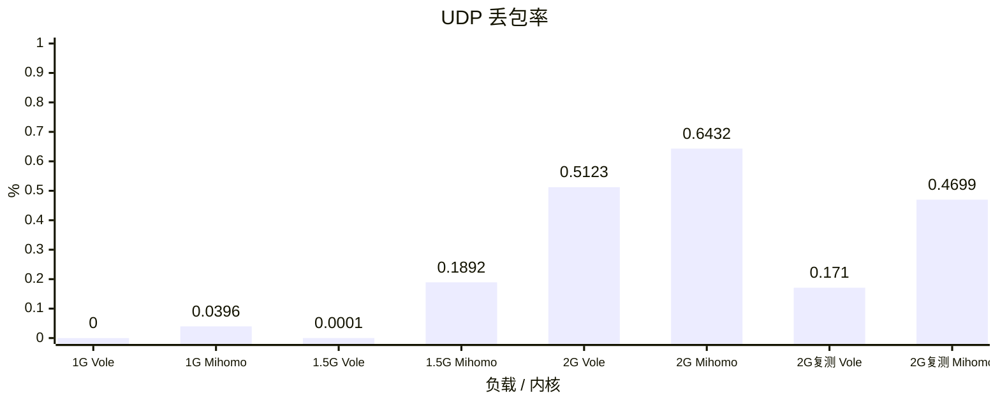

# Vole / Mihomo TUN benchmark

测试版本：Vole `96b665a`、Mihomo `v1.19.32`，两端均开启 Controller。
Linux 容器各 5 CPU、8 GiB；60 秒混合 TCP/UDP、64 条流、1000 DNS QPS，完整 `geosite:cn` / `geoip:cn`，DIRECT 出口。
CPU 100% 表示一个逻辑核；内存为 CLI 生命周期峰值 RSS，UDP 丢包按实际发送包数加权。

## 实际吞吐

## CPU

## 内存

## UDP 丢包率

